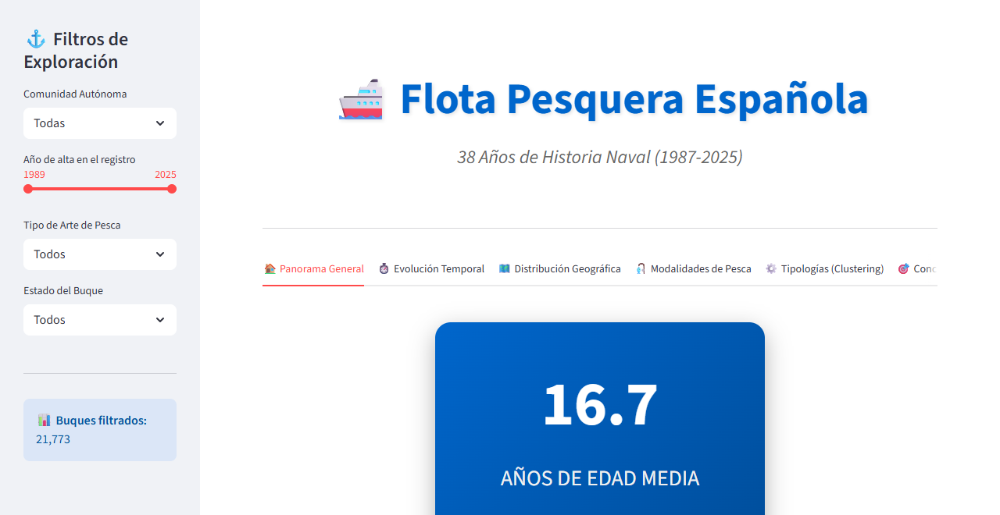

<div align="center">


# Dashboard de la flota pesquera española

Aplicación Streamlit para explorar la evolución, la distribución geográfica y las tipologías de la flota pesquera española entre 1987 y 2025.

    



<sub>Captura del dashboard ejecutado en local.</sub>

</div>

---

## Descripción general

El registro de la flota pesquera tiene decenas de miles de buques con datos técnicos y administrativos. Este dashboard lo convierte en una herramienta de consulta: cualquier persona puede filtrar la flota y ver cómo han cambiado su tamaño, su potencia y su reparto por comunidades y modalidades de pesca.

Parte del conjunto de datos obtenido y limpiado en [datos-web-scraping-flota](https://github.com/JulioUQ/datos-web-scraping-flota) y [ml-flota-pesquera](https://github.com/JulioUQ/ml-flota-pesquera).

## Funcionalidades

- **Filtros globales:** comunidad autónoma, rango de años de alta, arte de pesca y estado del buque.
- **Seis pestañas:** panorama general, evolución temporal, distribución geográfica por comunidades y puertos, modalidades de pesca, tipologías y conclusiones.
- **Tipologías de buques** con K-means sobre las variables técnicas y visualización en 3D.
- **Gráficos interactivos** de Plotly: composición por arte y material del casco, distribución por eslora y edad, puertos principales.

## Tecnologías y herramientas

| Ámbito | Herramientas |
| --- | --- |
| Aplicación | Streamlit |
| Gráficos | Plotly |
| Datos y modelos | pandas, NumPy, scikit-learn (K-means) |

## Estructura del proyecto

```text
.
├── dashboard_flota.py      # Aplicación Streamlit
├── 3. Datos/               # Histórico de la flota (CSV) y capas administrativas (Git LFS)
├── 5. Scripts/             # Notebook de preparación y versiones anteriores del dashboard
├── 7. Visualizaciones/     # Gráficos y mapas exportados en HTML
├── 1. Antecedentes/        # Limpieza y modelado previos del conjunto de datos
├── utils/                  # Funciones auxiliares
└── requirements.txt
```

## Instalación y uso

Los datos geoespaciales se guardan con Git LFS. Clona el repositorio con LFS instalado y ejecuta:

```bash
pip install -r requirements.txt
streamlit run dashboard_flota.py
```

## Resultados

- [Caso de estudio en el portfolio](https://juliouq.github.io/Portfolio-Web---JulioUQ/es/casos/flota-pesquera/): análisis de la flota con un gráfico interactivo de su evolución.

## Aspectos técnicos destacados

- Carga cacheada (`st.cache_data`) para que los filtros respondan sin releer los datos.
- Un único conjunto de filtros alimenta todas las pestañas, gráficos y mapas.
- Segmentación no supervisada integrada en la propia aplicación, con elección del número de grupos.

## Autor

**Julio Úbeda Quesada** · Data Scientist

[](https://juliouq.github.io/Portfolio-Web---JulioUQ/es/) [](https://www.linkedin.com/in/juliouq/) [](https://github.com/JulioUQ)
